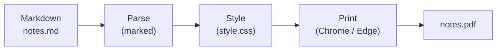
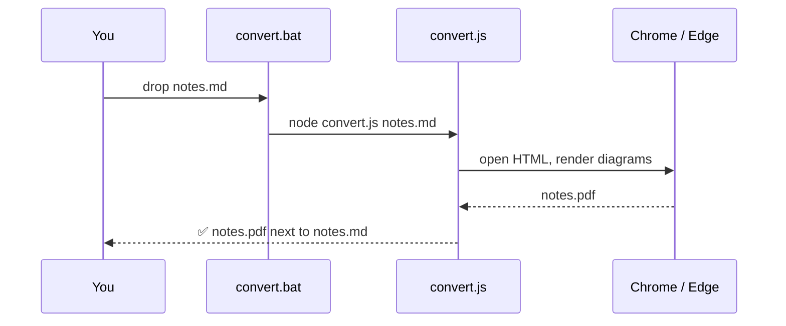

# Project Phoenix — Status Report

This sample document shows what **md2pdf** makes of everyday Markdown:
headings, *emphasis*, `inline code`, [links](https://github.com/pawagit/md2pdf),
tables, task lists, code blocks, quotes and Mermaid diagrams — all styled by
`style.css`.

## Summary

> **On track.** The rendering pipeline landed this week and the first
> end-to-end conversion passed on a clean machine — no admin rights,
> no bundled browser, no cloud round-trip.

The team closed **14 issues** this sprint. The remaining risk is the font
fallback on machines without *Segoe UI*, tracked in `#42`.

## Milestones

| Milestone            | Owner  | Due        | Status      |
| -------------------- | ------ | ---------- | ----------- |
| Rendering pipeline   | Ana    | 2026-07-03 | ✅ Done     |
| Theme system         | Ben    | 2026-07-10 | ✅ Done     |
| Drag & drop launcher | Chris  | 2026-07-17 | 🔄 In work  |
| Public release       | Dana   | 2026-07-24 | ⏳ Planned  |

## This week

- [x] Wire up headless Chrome via `puppeteer-core`
- [x] Ship `comfortable` and `compact` themes
- [x] Add page numbers to the PDF footer
- [ ] Write the release announcement
- [ ] Tag `v1.0.0`

## Diagrams

Fenced code blocks tagged `mermaid` are rendered as vector diagrams, in the
same colours as the rest of the document:



Sequence, class, state, ER and Gantt diagrams work the same way:



### How the conversion works

The converter reads each Markdown file, wraps the parsed HTML with the
stylesheet, and hands it to the browser's print engine:

```js
const html = buildHtml(markdown, css, title, theme);
await page.setContent(html, { waitUntil: "networkidle0" });
await page.pdf({ path: outPath, format: "A4", printBackground: true });
```

Three steps, no magic:

1. **Parse** — `marked` turns Markdown into HTML (GitHub flavored)
2. **Style** — the HTML is wrapped with the CSS from `style.css`
3. **Print** — Chrome or Edge renders the final PDF, headless

#### Configuration

The active theme lives in `config.json`; margins are applied per theme by the
PDF engine rather than by CSS:

```json
{
  "theme": "compact"
}
```

---

*Generated with [md2pdf](https://github.com/pawagit/md2pdf) — drop this file
onto `convert.bat` to reproduce the PDF.*
